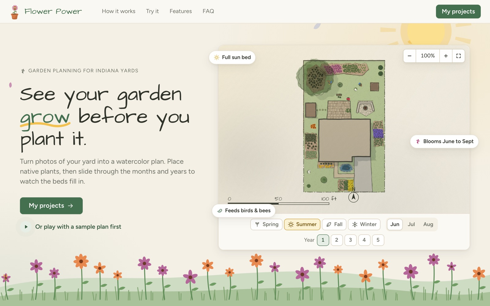
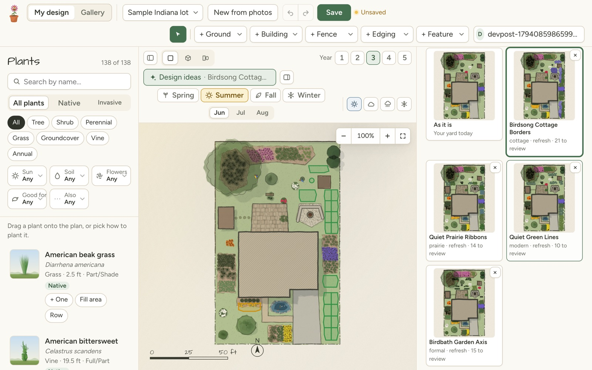
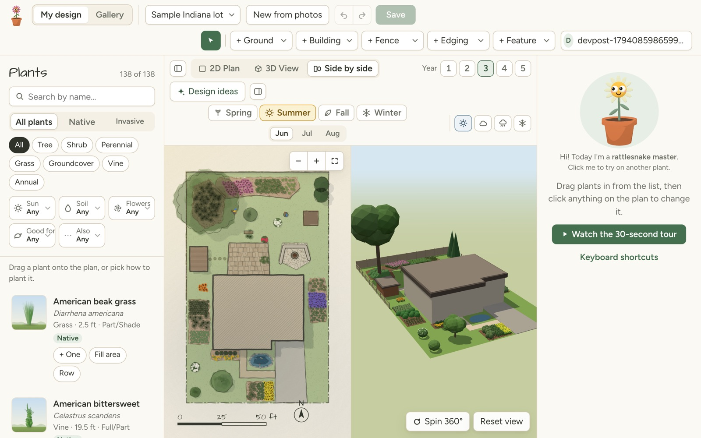
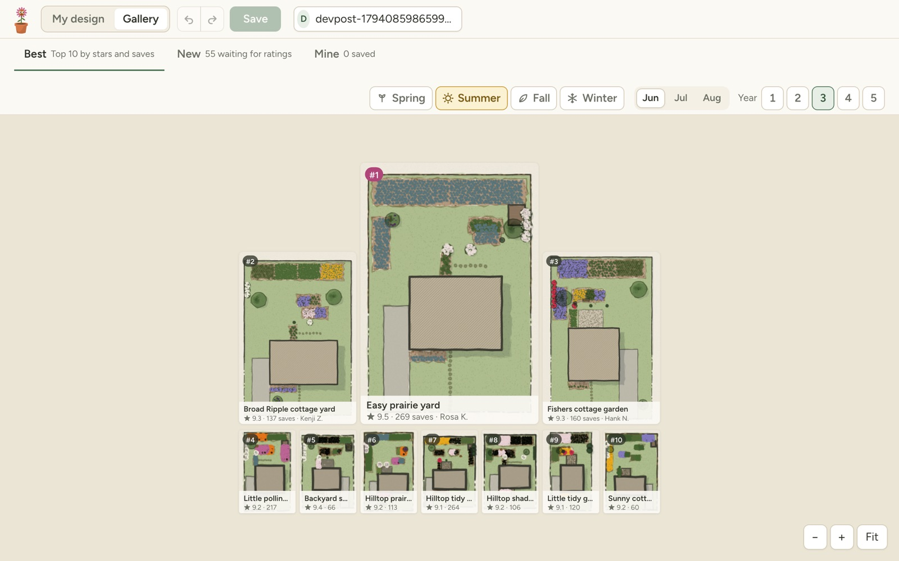
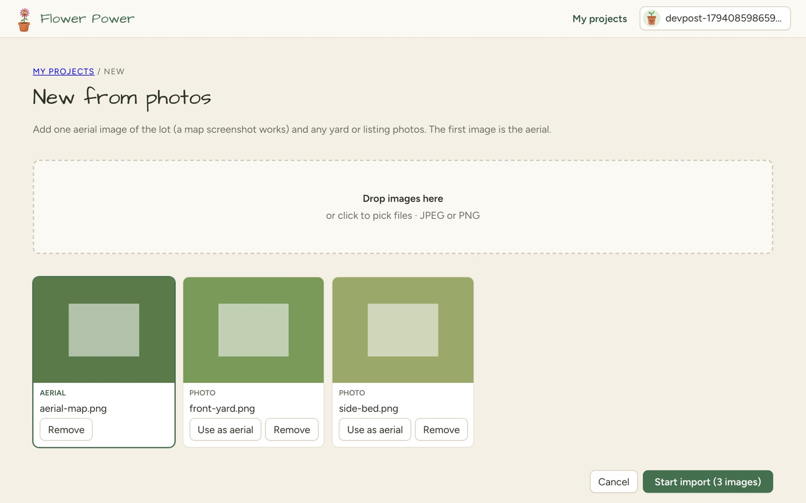
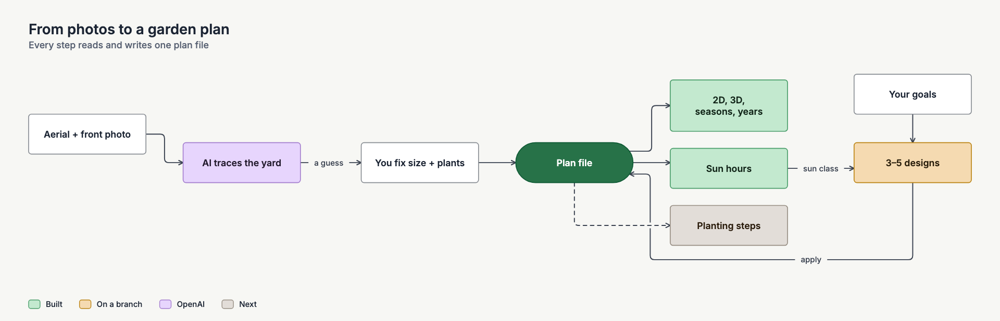
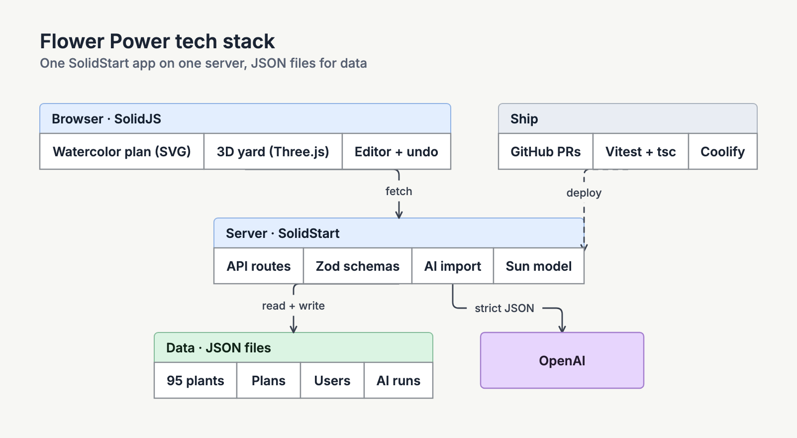

# Flower Power

Flower Power is a garden planner for Indiana homeowners. Start from photos of your own yard, get a watercolor plan of what's there, then try changes and see them through the seasons and the next five years.

- Live app: https://flower-power.apps.byroni.us
- Devpost (Indy Init 2026): https://devpost.com/software/flower-power-bford0



## What works now

- **Start from photos.** Drop a top-down aerial and a front photo on one page, and pick which one is the aerial. The AI (OpenAI `gpt-6.1-terra`) traces the house, lot, beds, fences and trees, and guesses which plants are there. You fix one size and confirm the guesses.
- **Edit the plan.** A watercolor plan you can draw on: plants, rows, filled areas, beds, paths, fences and structures, with undo.
- **See it change.** Seasons, months, and years 1 to 5, in 2D, 3D, or side by side.
- **Sun and shade.** A sun model gives hours of direct sun for every 2 ft square: full sun, part sun or shade.
- **Design ideas.** Give goals and a dial (Light touch, Refresh, Redo). You get a review of the yard, then 3 to 5 designs in different styles. Accept or reject each change, or rework one area.
- **Gallery.** Best, New and Mine, with a Public switch. Public gardens leave out the address and aerial. The community is sample data for now.
- **153 Indiana plants**, with the 15 invasive ones flagged.
- **Accounts.** Email and password; you see only your own plans. A share link shows the design you picked.
- **Demo login.** `demo@flower.test` / `flowerdemo`. Each login resets it to the sample lot. `demo/README.md` has a 5-minute demo script.

| Design ideas | 2D and 3D |
| --- | --- |
|  |  |





## How it fits together





How we built it in one day: [process diagram](docs/hackathon/process.png) and the [Devpost story](docs/hackathon/devpost.md).

## Run it

The app uses SolidStart, TypeScript, and pnpm, on Node 20 to 22.

```bash
pnpm install
pnpm dev
```

Put `OPENAI_API_KEY` in `.env` for photo import and design ideas. Set `AI_FAKE=1` to replay saved AI runs with no paid calls. `SESSION_SECRET` is made on first use if you don't set it.

`pnpm test` runs the tests, including a check of every plant and property file. `pnpm typecheck` checks the TypeScript.

Dev pages: `/dev/import`, `/dev/eval` (import eval runs), `/dev/sun` (sun hours), and `/dev/designs`.

## Data

- `data/plants/`: one JSON file for each plant. See [data/plants/README.md](data/plants/README.md) to add a plant.
- `data/properties/`: one JSON file for each property. The schema is in `src/model/property.ts`.
- `data/users/`, `data/ai-runs/`, `data/images/`: per-user plans, saved AI runs, and uploaded photos. These are not committed.

## Planning documents

The [intent index](docs/intent/README.md) lists each part of the product with its intent brief. The product brief, shape and spikes are in [docs/intent/garden-design-app/](docs/intent/garden-design-app/). The [plan overview](https://claude.ai/artifact/LLiJW3prBD1RbqrwGhM5cB) is a one-page summary.

## Updating the Devpost page

The Devpost story and diagrams live in [docs/hackathon/](docs/hackathon/). See its [README](docs/hackathon/README.md) for the links and steps.
